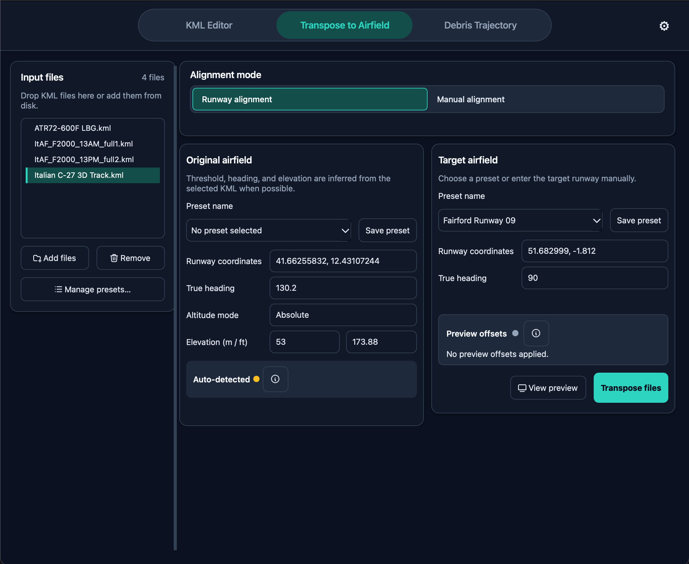
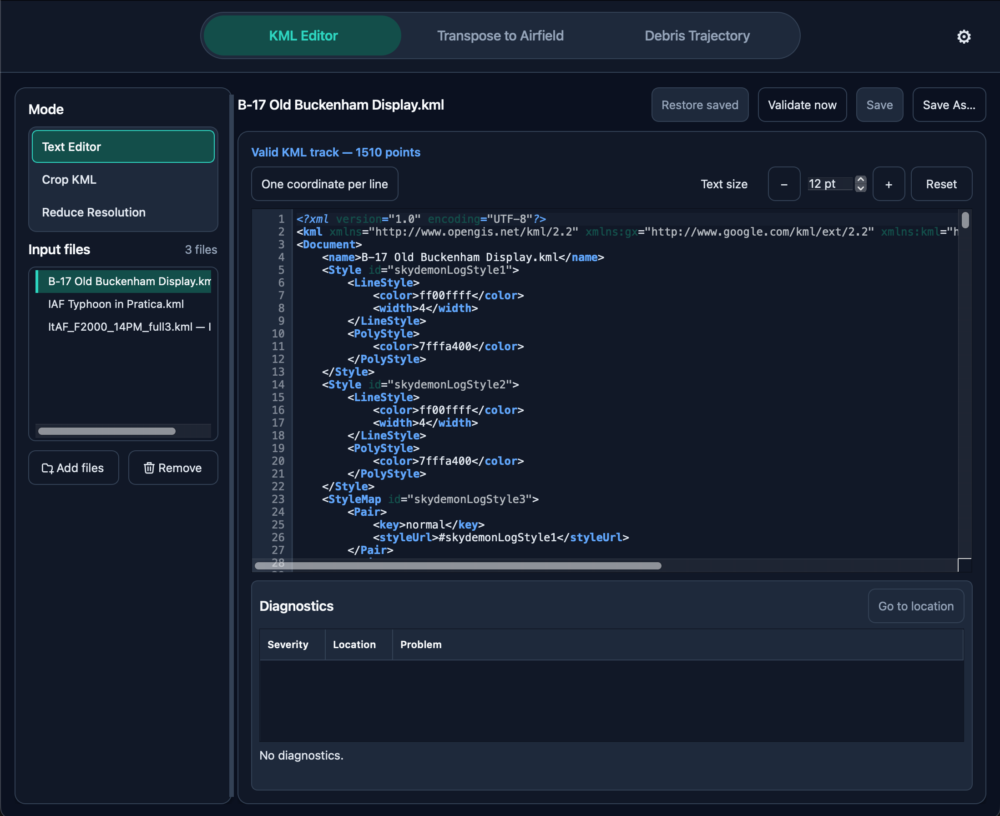
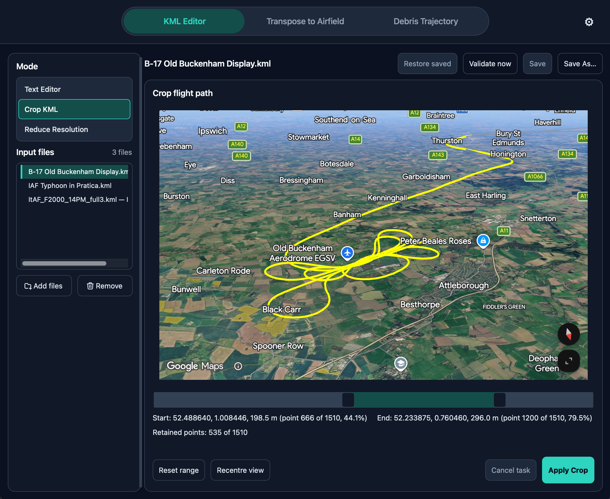
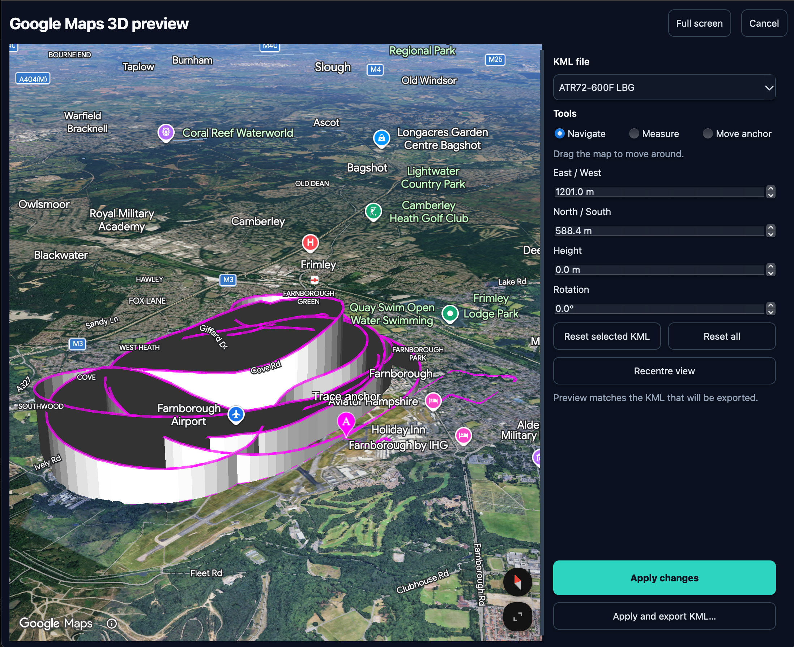
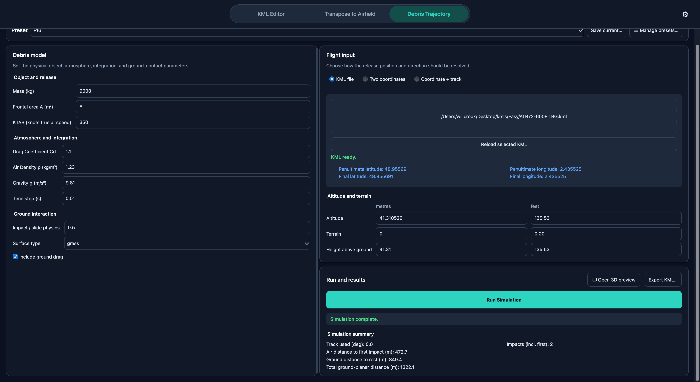
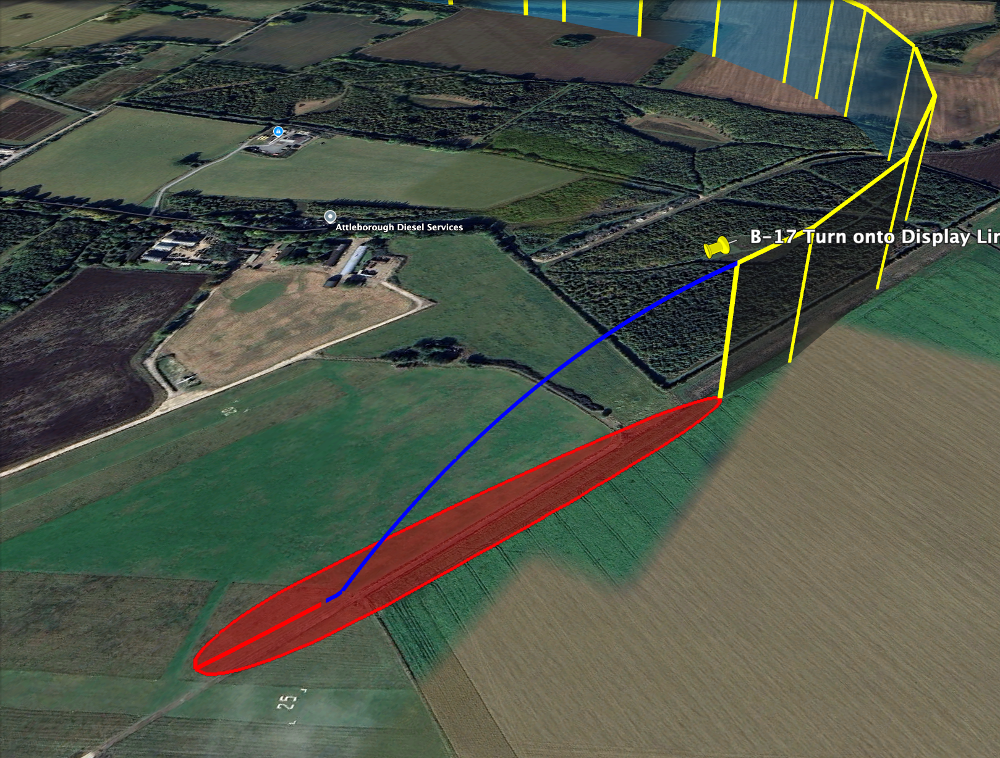

# Tasmead Display Tools

Desktop tools for preliminary aircraft display planning, KML route editing and visualisation.

[Browse releases](https://github.com/WillCrook/Tasmead-Display-Tools-Release/releases)

## What it does

- **Edit KML routes** — inspect and validate files, crop tracks, or reduce coordinate count.
- **Prepare routes for another airfield** — use runway alignment or manual settings, then export the adjusted route as KML.
- **Explore debris trajectories** — adjust object, flight and surface inputs and review estimated impact and distance summaries.
- **Preview routes in 3D** — compare and adjust traces, measure distances and export the result.

### KML editor

### 3D visualiser

### Debris trajectory analysis

## Downloads

Release downloads and version notes are published on the [Releases page](https://github.com/WillCrook/Tasmead-Display-Tools-Release/releases). The currently supported platform is **macOS on Apple silicon (arm64)**.

The optional Google Maps 3D preview requires an internet connection and a Google Maps API key. The installer is unsigned and the app is not notarized, so macOS Gatekeeper may require a security approval.

## Intended use

Tasmead supports preliminary planning and visualisation. Its estimates do not establish safety, operational feasibility or regulatory compliance. Qualified personnel should independently review the data, assumptions and results, and complete all required assessments, approvals, testing and rehearsal.

## Licence

Tasmead’s application terms are described in [LICENSE](LICENSE). This repository contains release files, not the application source. Third-party components retain their own licences; each release includes the relevant notices and source materials.